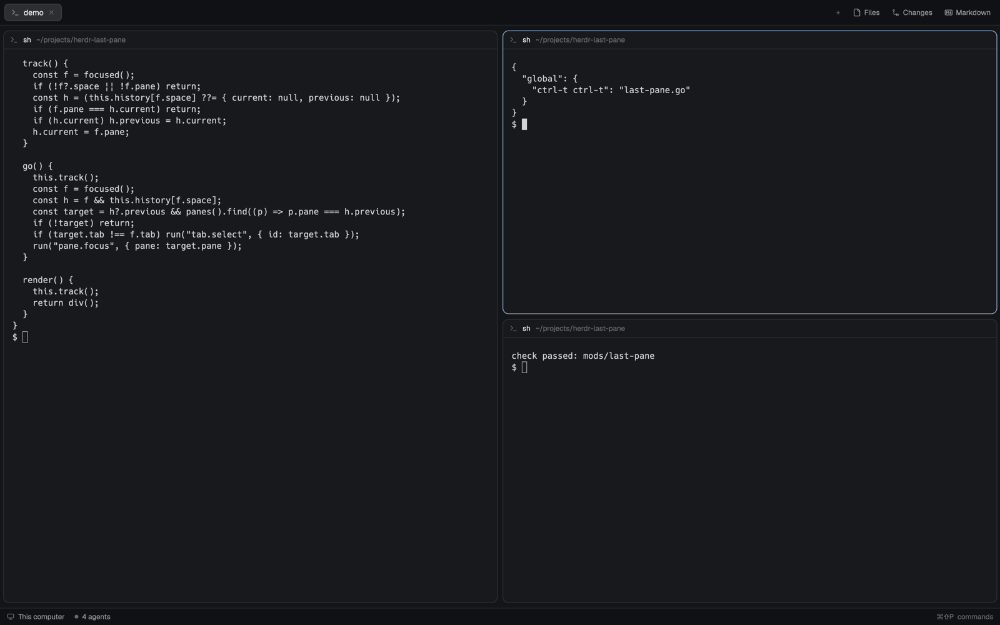

# herdr-last-pane

A [Herdr](https://herdr.dev) mod: go back to the pane you were just in, like tmux's `last-pane`.



- `ctrl-t ctrl-t` focuses the pane you were in before this one. Press it again to come back:
  it flips between the last two panes. That's this mod's default; tmux's is `prefix ;`, so
  pick your own (below).
- It remembers one pane per space. Going back stays in the space you're looking at, and
  switches tabs in it when the pane you were in is in another tab.
- Any way of moving counts: clicking a pane, a key bound to `pane.go`, showing another tab,
  `agent.next`, a notification.
- It draws nothing. It lives in an empty floating block of your layout, so it keeps running
  while you work.

The Herdr desktop app has no last-pane command of its own (`herdr-app commands` lists
`pane.focus`, `pane.go`, `tab.prev` and `space.prev`, none of which go back to where you were).
Herdr TUI has a `last_pane` key action; this brings the same idea to the desktop app.

## How it differs from tmux

- **Across tabs.** tmux's `last-pane` stays in the current window. Here the last pane can be in
  another tab of the space: going back shows that tab first.
- **Per space.** tmux remembers the last pane per window; this remembers it per space. Going
  back in another space uses that space's own last pane, never one from elsewhere.
- **Nothing to go back to.** When the pane you were in has been closed, or you haven't moved
  since the window opened, the key does nothing (tmux says "no last pane").
- **Kept in memory.** Restarting Herdr, saving the mod (a reload) or switching to another
  layout starts with no history.

## Install

Ask your agent to add it (it reads `~/.config/herdr-app/AGENTS.md` and the recipe, and renames
the mod if the name is taken), or by hand:

1. Copy the mod, unless a folder of that name is already there (don't overwrite it):

   ```sh
   dest=~/.config/herdr-app/mods/last-pane
   if [ -e "$dest" ]; then
     echo "$dest already exists: remove it or install under another name"
   else
     cp -R mods/last-pane "$dest" && herdr-app check "$dest"
   fi
   ```

2. Put it in your layout as an empty floating block. `mod.json` has `"place": "none"`, so Herdr
   doesn't dock it anywhere by itself. Herdr's own layouts are read-only (an edit is moved
   aside on the next start), so clone yours first if you haven't:

   ```sh
   herdr-app do layout.clone '{"name":"main","as":"my-main"}'
   ```

   In `~/.config/herdr-app/layouts/my-main.json`, add this to the root node (or append the
   entry if the root already has a `"floating"` list):

   ```json
   "floating": [
     { "id": "last-pane", "content": { "mod": "last-pane" }, "edge": "bottom", "align": "start" }
   ]
   ```

   It renders nothing, so nothing shows. Check `layout.error` after saving. Each layout you use
   needs its own copy of the block.

3. Merge [`keys.json`](keys.json) into `~/.config/herdr-app/keys.json`:

   ```json
   { "global": { "ctrl-t ctrl-t": "last-pane.go" } }
   ```

   Check that nothing else already uses the key. `ctrl-t` is also a key shells and programs
   use (transpose characters, fzf's file search): binding a `ctrl-t …` sequence takes plain
   `ctrl-t` away from them. If you already use `ctrl-t` as a prefix, bind `ctrl-t a` to
   `send:\u0014` to type a literal one. To use tmux's key with a `ctrl-b` prefix, bind
   `"ctrl-b ;": "last-pane.go"` instead.

Installing under another folder name means renaming `last-pane` in the layout's `"mod"` and in
your key (`<name>.go`).

## Test

With Herdr open and the mod installed as above, `python3 test/e2e.py` makes a throwaway space,
checks going back within a tab, across tabs, per space and with the last pane closed, then
closes the space and puts your focus back.

## What it runs

Nothing. It runs no programs, reads and writes no files, and makes no network requests. It
reads Herdr's focus and panes, and runs `tab.select` and `pane.focus`.

## License

MIT. See [LICENSE](LICENSE). [RECIPE.md](RECIPE.md) describes the mod for building it from
scratch.
