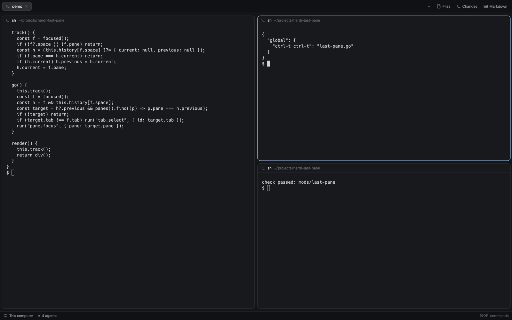

# Last pane

Go back to the pane you were just in: tmux's `last-pane` for Herdr. Prefix, then `ctrl-t`
(`ctrl-t ctrl-t` with a `ctrl-t` prefix) focuses the pane you were in before this one, switching tabs within the space when
needed, and pressing it again comes back. Nothing is drawn: the mod sits in an empty floating
block of the layout and watches focus. This is a piece you add to your current layout, not a
whole window.



This file is the brief: enough to build Last pane from an empty folder. The files next to it
are one build of it. If they don't work on your Herdr, or you want it different, build it again
from here.

## What you see

- Nothing new. The mod renders an empty `div()`, so its floating block is 0 × 0 px and Herdr
  draws no frame around it. The screenshot is an ordinary split tab; the focused pane has the
  layout's `accent` focus border.
- Pressing the key moves that focus border to the pane you were in before, and shows its tab if
  it's in another one.

## How it behaves

It shows no agents, so agent statuses (working, blocked, done, idle) don't change it.

- **It remembers two panes per space**: the one focused now and the one focused before it. Any
  change of `focused().pane` counts, however it happened: a click, `pane.go`, `pane.focus`,
  showing another tab, `agent.next`, a notification, this mod's own key.
- **`last-pane.go`** (bound to prefix, then `ctrl-t`: `ctrl-t ctrl-t` in the repo's `keys.json`) focuses the space's
  previous pane. If it's in another tab of the space, that tab is shown first. The pane you left
  becomes the previous one, so pressing again flips back: it toggles between the last two panes,
  as tmux's does. Three panes A → B → C: the key goes to B, then to C, then to B.
- **Per space.** In another space, the key uses that space's own history and never leaves it.
  A space you haven't moved in since the mod started has none: the key does nothing.
- **A closed pane is skipped quietly.** If the previous pane no longer exists (`panes()` doesn't
  list it), the key does nothing. There's no message.
- A focused layout terminal block (`focused().pane` is null) isn't recorded, and the key does
  nothing while one is focused.
- History is in memory: a restart, a reload of the mod (saving its files) or a layout switch
  starts empty.

## Built from

- **One mod, `mods/last-pane/`**, with `main.js` and `mod.json`:
  `{ "place": "none", "title": "Last pane" }`. `"none"` keeps Herdr from docking a panel for it.
- **A floating block in the person's layout** (a clone, since Herdr's are read-only), on the root
  node:

  ```json
  "floating": [
    { "id": "last-pane", "content": { "mod": "last-pane" }, "edge": "bottom", "align": "start" }
  ]
  ```

- **A `keys.json` snippet**, merged into the person's keys:

  ```json
  { "global": { "ctrl-t ctrl-t": "last-pane.go" } }
  ```

  The first `ctrl-t` is the prefix. Herdr has no prefix setting, only two-key sequences, so
  the prefix is written out: with `ctrl-b` as the prefix it's `"ctrl-b ctrl-t"`. Use the
  person's prefix. `last-pane.go` reaches the mod through `nextCommand()` as `"go"`.
- **State**: `this.history`, `{ [space id]: { current, previous } }` (pane ids), made in `init`.
- **`track()`** reads `focused()`; with no `space` or no `pane` it returns. When `pane` differs
  from that space's `current`, the old `current` becomes `previous` and `pane` becomes `current`.
  It runs on every `render()` and every 300 ms (`cx.timer.every(300, …)`). The timer only reads
  in-memory state and calls nothing that redraws.
- **`go()`** calls `track()` first, then finds `previous` of the focused space in `panes()`. If
  found: `run("tab.select", { id: pane.tab })` when its tab isn't `focused().tab`, then
  `run("pane.focus", { pane })`. It doesn't update the history itself: the next `track()` sees
  the new focus and swaps `current` and `previous`.
- **Commands loop**: `cx.spawn(async (cx) => { for (;;) { if ((await nextCommand()) === "go")
  this.go(); cx.notify(); } })` in `init`.
- **Herdr API**: `panes`, `focused`, `run` (`tab.select`, `pane.focus`), `nextCommand`.
- No art, no fonts, no `exec`, no files, no network.

## Watch out

- **Herdr has no last-pane command** (herdr-app 0.1.11): no focus history is exposed, so the mod
  keeps its own by watching `focused()`.
- **Focus can change without a redraw** of the mod (for instance while the window isn't drawing),
  so tracking only in `render()` can miss a move. The 300 ms timer covers that. Don't
  `cx.notify()` from it: every redraw redraws the whole window.
- **The copy has to be shown.** `<mod>.<command>` reaches shown copies only, so the block must be
  one that is always on screen: not a hidden column or an inactive stack child. An empty floating
  block on the root is always shown and takes no room. A docked panel (`place: "left"` etc.)
  would take room for nothing.
- **Each layout needs its own block**, and another layout starts its mods fresh: switching
  layouts loses the history, and a layout without the block ignores the key.
- **`run()` doesn't wait** for the command to land, so `go()` must not record the target itself;
  let the next `track()` see it.
- `herdr-app do pane.go '{"direction":"left"}'` from a shell didn't move focus in testing (0.1.11),
  so scripted checks use `pane.focus` to move between panes. `pane.go` bound to a key works.
- Binding `ctrl-t ctrl-t` takes plain `ctrl-t` from terminal programs (shells' transpose
  characters, fzf's file search). Tell the person, or use their own prefix.
- Follow the installed `herdr.d.ts` and `gpui-kit.d.ts`; never modify shipped mods or layouts.

## Done when

- `herdr-app check ~/.config/herdr-app/mods/last-pane` passes.
- With the floating block in the shown layout, `herdr-app status` lists a `last-pane` float with
  0 × 0 bounds, `layout.error` doesn't exist, and nothing new is visible in the window.
- In a tab split into A | B / C: focus B, then C; the key focuses B; again, C.
- Then focus A; the key focuses C (only the last pane is remembered, as in tmux).
- In a new tab of the same space, the key goes back to that pane in tab 1, showing tab 1; again,
  back to the new tab.
- In another space the key stays in that space.
- Focus A, then C, close A: the key leaves focus on C.
- The same checks work from a shell with `herdr-app do last-pane.go`, waiting ~0.5 s after each
  focus change.
